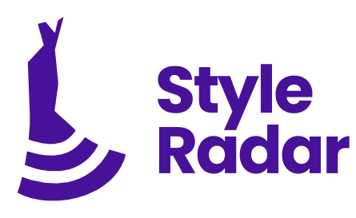

# StyleRadar-Frontend

Frontend de StyleRadar, la plataforma que conecta a compradores con los almacenes de moda locales de Bogotá: buscar prendas en su talla, verlas en el mapa, probarlas en un probador virtual y vender o donar ropa usada.

Proyecto del curso DOSW, Escuela Colombiana de Ingeniería Julio Garavito, 2026-2. Organización: StyleRadar1.

## Integrantes del equipo de frontend

- Kevin Ángel
- Julián Morales
- Carlos Sánchez
- Cristian Moreno
- Daniel Barrera

## Estado

El proyecto en React tiene la base común lista (rutas por rol, inicio de sesión, acceso para jurados, cliente HTTP y design system) y el catálogo funcionando con datos de prueba. Las demás vistas están creadas como pantallas pendientes, cada una con su squad y sus requerimientos, y se van migrando desde el prototipo.

El prototipo navegable completo, en HTML, está en `public/prototipo/` y se abre en `/prototipo/index.html`. Es la referencia de diseño para todas las vistas.

## Tecnologías

React 19, TypeScript, Vite, Tailwind CSS 4, React Router y Axios. Se despliega en Vercel.

## Cómo ejecutarlo

Se necesita Node.js 20 o superior.

```
npm install
cp .env.example .env
npm run dev
```

En Windows, el segundo comando es `copy .env.example .env`.

Abrir http://localhost:5173.

Otros comandos: `npm run build` (compila), `npm run preview` (sirve lo compilado) y `npm run lint` (revisa el código).

### Variables de entorno

| Variable | Para qué sirve |
|---|---|
| `VITE_API_URL` | URL del API Gateway (sr-api-gateway). El front solo habla con el gateway. |
| `VITE_USE_MOCKS` | `true` mientras el backend no esté listo: los servicios responden con datos de prueba. |

### Cuentas de prueba

La contraseña de todas es `1234`: usuario@styleradar.co, luna@styleradar.co (tienda), abrigo@styleradar.co (fundación) y admin@styleradar.co. En `/login?jurado` aparecen como botones de un clic, para el kit de los jurados.

## Estructura

Se usa el nivel 3 de organización visto en clase: agrupación por módulos. Cada módulo corresponde a un squad y a sus microservicios, así cada equipo trabaja en su carpeta.

```
src/
├── app/                 router, rutas por rol y layouts
├── configs/             variables de entorno
└── modules/
    ├── core/            base común: apiClient, design system, tipos
    ├── landing/         página de bienvenida
    ├── identidad/       Squad 1
    ├── catalogo/        Squad 2
    ├── experiencia/     Squad 3
    ├── transacciones/   Squad 4
    └── soporte/         Squad 5
public/
├── img/                 imágenes
└── prototipo/           prototipo en HTML (referencia de diseño)
docs/                    documentación del proyecto
```

Dentro de cada módulo: `components/`, `hooks/`, `services/`, `states/`, `types/`, `mocks/`, `pages/` y `utils/`, según se necesiten. Cada módulo tiene un README con su squad, sus requerimientos y sus pantallas.

## Reparto por squad

| Módulo | Squad | Microservicios | Requerimientos |
|---|---|---|---|
| identidad | 1 · Identidad (CADCHE) | Authentication, Usuarios, Tiendas | RF 1–6, 62–66, 92 |
| catalogo | 2 · Catálogo (RST) | ItemCatalog, Inventory, Geolocation, Playlist | RF 7–22, 28, 33–39, 50–61, 69–72, 74 |
| experiencia | 3 · Experiencia (PT8080) | VirtualTryOn, Donations | RF 23–27, 42–49 |
| transacciones | 4 · Transacciones | Pagos y suscripciones | RF 67, 68, 75, 93–103 |
| soporte | 5 · Soporte (GJ) | Notification, Chat, Estadísticas | RF 29–32, 40, 41, 73, 76–91 |
| core, landing | Base común | API Gateway | Router, roles, design system, landing y acceso para jurados |

## Cómo agregar una pantalla

1. Definir los DTOs en `types/` según el Swagger del microservicio.
2. Crear el servicio en `services/` con `apiClient` y, mientras tanto, su versión con datos de `mocks/`.
3. Crear un hook en `hooks/` que llame al servicio y maneje la carga y los errores.
4. Crear la página en `pages/` y registrarla en `src/app/router.tsx` con los roles que la pueden ver.

El ejemplo completo está en el catálogo: `CatalogPage.tsx` → `useItems.ts` → `itemService.ts`.

## Forma de trabajo

- `main` tiene la versión entregable y `develop` la de integración.
- Cada tarea va en una rama `feature/<modulo>-<tarea>` (por ejemplo `feature/catalogo-filtro-talla`) que sale de `develop`.
- Los cambios entran a `develop` por pull request revisado por otra persona; a `main` solo desde `develop`.
- Los commits van en español: `feat(catalogo): agregar filtro por talla`, `fix(identidad): validar correo`.
- El CI compila y revisa el código en cada pull request.

## Documentación

Toda la documentación del front está en `docs/`. El índice con la descripción de cada documento está en [docs/README.md](docs/README.md).

| Carpeta | Contenido |
|---|---|
| `docs/arquitectura/` | Documento de arquitectura y diseño del front v3.0, figuras y versiones anteriores |
| `docs/diagramas-flujo/` | Flujo de navegación entre pantallas para cada rol |
| `docs/requerimientos/` | Requerimientos funcionales y su recorrido en el prototipo |
| `docs/identidad/` | Manual de identidad, logo, colores y personajes |
| `docs/marketing/` | Propuesta de marketing y cronograma |
| `docs/gestion/` | Reparto del front por squad, registro de cambios, sprints y presentación |
| `docs/plantillas/` | Plantilla institucional para los documentos del proyecto |
| `docs/diseno/` | Capturas actuales del prototipo y mockups anteriores |

## Identidad visual

Colores del manual: grafito `#262626`, blanco `#FFFFFF`, arena `#E8DCCB`, lavanda `#B9B9CA` y violeta `#48119A`. Tipografía Poppins. Están definidos en `src/index.css` y se usan como clases de Tailwind (`bg-violeta`, `text-arena`, etc.).
