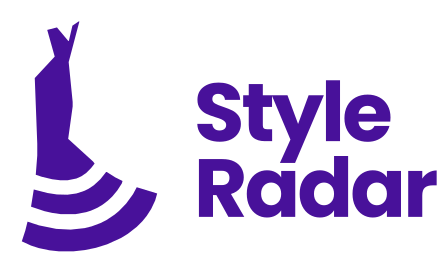

<!-- ==============================================================================
  STYLE RADAR · FRONTEND WEB (REACT + TYPESCRIPT + VITE)
  Asignatura: DOSW (Diseño y Operación de Soluciones Web) · 2026
  Organización: StyleRadar1
============================================================================== -->

<div align="center">

  <a href="https://github.com/StyleRadar1">
    <picture>
      <source media="(prefers-color-scheme: dark)" srcset="docs/identidad/logo/styleradar-logo-negativo.svg" />
      <source media="(prefers-color-scheme: light)" srcset="docs/identidad/logo/styleradar-logo.svg" />
      
    </picture>
  </a>

  <h1>STYLE<font color="#5600EF">RADAR</font> &nbsp;·&nbsp; <code>Frontend</code></h1>

  <p align="center">
    
    
    
    
  </p>

  <p align="center">
    <strong><font color="#5600EF">Descubre tu estilo. En tu ciudad.</font></strong><br />
    <em>Aplicación web en React que conecta a compradores con almacenes de moda local de Bogotá: catálogo personalizado, mapa interactivo, probador virtual con IA, segunda vida, donaciones, suscripciones y cumplimiento legal colombiano.</em>
  </p>

  <p align="center">
    <a href="docs/secciones/04-entornos-variables-y-despliegue.md"></a>
    <a href="https://styleradar-qa.vercel.app/"></a>
    <a href=".github/workflows/ci.yml"></a>
    <a href="docs/secciones/06-pruebas-y-cicd.md"></a>
    <a href="docs/secciones/03-tecnologias-y-design-system.md"></a>
  </p>

  <p align="center">
    <a href="docs/secciones/03-tecnologias-y-design-system.md"></a>
    <a href="docs/secciones/03-tecnologias-y-design-system.md"></a>
    <a href="docs/secciones/03-tecnologias-y-design-system.md"></a>
    <a href="docs/secciones/03-tecnologias-y-design-system.md"></a>
    <a href="docs/secciones/03-tecnologias-y-design-system.md"></a>
    <a href="docs/secciones/03-tecnologias-y-design-system.md"></a>
  </p>

</div>

---

La aplicación web de **StyleRadar** integra **10 módulos funcionales**, **46 pantallas navegables** con carga diferida (*lazy loading*) y **31 servicios** conectados directamente al **API Gateway** de la plataforma. Cuenta con diseño adaptable, 3 temas visuales accesibles (oscuro, claro y daltónico), capa de cumplimiento legal colombiana (`/legal`) y suite automatizada con **90 archivos de pruebas**.

---

##  ÍNDICE DE CONTENIDOS

1. [Roles, módulos, squads y mapa de rutas](docs/secciones/01-roles-modulos-y-rutas.md)
2. [Arquitectura modular e integración con el API Gateway](docs/secciones/02-arquitectura-y-api-gateway.md)
3. [Tecnologías, Design System y accesibilidad visual](docs/secciones/03-tecnologias-y-design-system.md)
4. [Entornos, variables de entorno y despliegue en Vercel](docs/secciones/04-entornos-variables-y-despliegue.md)
5. [Manejo de errores y cumplimiento legal](docs/secciones/05-errores-y-cumplimiento-legal.md)
6. [Pruebas automatizadas, linter y CI/CD](docs/secciones/06-pruebas-y-cicd.md)
7. [Ramas, convenciones y equipo de frontend](docs/secciones/07-ramas-contribucion-y-equipo.md)

---

##  ENTORNOS Y DESPLIEGUE

| Entorno | Estado | URL Frontend | Backend (API Gateway) | `VITE_USE_MOCKS` |
| :--- | :---: | :--- | :--- | :---: |
| **Desarrollo Local** | Activo | `http://localhost:5173` | `VITE_API_URL` (`http://localhost:8080` o Gateway QA) | `true` / `false` |
| **QA Cloud (Vercel)** | Activo | [`https://styleradar-qa.vercel.app/`](https://styleradar-qa.vercel.app/) | `https://styleradar-gateway-qa.azurewebsites.net` | `false` |
| **Producción** | Configurado | Dominio productivo Vercel | URL oficial del Gateway productivo | `false` |

> [!IMPORTANT]
> El frontend **nunca se comunica directamente con los puertos individuales de los microservicios**. Toda petición HTTP sale hacia `VITE_API_URL` (API Gateway), con `Authorization: Bearer <token>` y `VITE_USE_MOCKS=false` en QA y Producción.

---

##  INICIO RÁPIDO EN LOCAL

Prerrequisito: **Node.js 22 LTS** (alineado con CI) y `npm`.

```bash
# 1. Clonar el repositorio
git clone https://github.com/StyleRadar1/StyleRadar_Frontend.git
cd StyleRadar_Frontend

# 2. Instalar dependencias
npm install

# 3. Configurar variables de entorno
cp .env.example .env            # Linux / macOS
# copy .env.example .env        # Windows (CMD / PowerShell)

# 4. Levantar servidor de desarrollo en http://localhost:5173
npm run dev
```

| Comando | Propósito |
| :--- | :--- |
| `npm run dev` | Servidor de desarrollo Vite con recarga rápida (`http://localhost:5173`) |
| `npm run build` | Verificación TypeScript (`tsc -b`) y compilación para producción |
| `npm run build:qa` | Verificación TypeScript (`tsc -b`) y compilación con perfil `--mode qa` |
| `npm run lint` | Análisis estático de código con `oxlint` |
| `npm test` / `npm run test:watch` | Suite de pruebas unitarias e integración con Vitest |

---

##  DOCUMENTOS COMPLEMENTARIOS

* [Índice documental completo del proyecto](docs/README.md) — Arquitectura v3.0, diagramas de flujo por rol, requerimientos y manual de identidad.
* [Guía unificada de manejo de errores](README-ERRORES.md) — Escenas visuales, componentes transversales y catálogo de escenarios `?mock=<escenario>` en desarrollo.
* [Registro de cumplimiento legal](LEGAL_PENDIENTES.md) — Cobertura normativa colombiana, banner de cookies y documentos de `/legal`.
