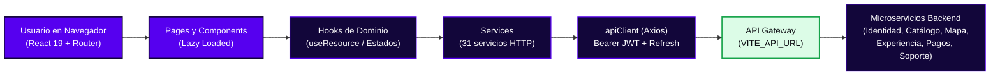

[⬅ Volver al README Principal](../../README.md)

---

##  2. ARQUITECTURA MODULAR E INTEGRACIÓN CON EL API GATEWAY

El proyecto sigue una arquitectura modular de **nivel 3 (agrupación por dominio/squad)** sobre React 19 + TypeScript, con separación estricta entre vistas, estado/hooks, servicios HTTP y tipos DTO.

### Estructura del Repositorio

```text
StyleRadar_Frontend/
├── .github/
│   ├── pull_request_template.md
│   └── workflows/
│       └── ci.yml                 # Lint, pruebas Vitest y build en PRs/push a develop y main
├── docs/
│   ├── README.md                  # Índice general de documentación del proyecto
│   ├── secciones/                 # Secciones modulares enlazadas desde el README principal
│   ├── arquitectura/              # Documento de arquitectura frontend v3.0 y figuras
│   ├── diagramas-flujo/           # Flujos de navegación por rol (PNG / SVG)
│   ├── diseno/                    # Capturas y material histórico de diseño
│   ├── gestion/                   # Documentos de gestión, reparto y sprints
│   ├── identidad/                 # Manual de identidad, logos, paleta y personajes
│   ├── plantillas/                # Plantillas institucionales
│   └── requerimientos/            # Trazabilidad de requerimientos v3 y recorrido
├── public/
│   ├── img/                       # Activos gráficos estáticos
│   ├── prototipo/                 # Prototipo HTML histórico (referencia visual)
│   └── video/                     # Recursos multimedia del landing
├── src/
│   ├── app/
│   │   ├── layouts/               # AppLayout y AdminLayout
│   │   ├── RequireRole.tsx        # Guarda de acceso por rol
│   │   ├── RequireStoreActiveSub.tsx # Guarda de suscripción activa para tiendas
│   │   └── router.tsx             # Enrutador principal con lazy loading por módulo
│   ├── configs/
│   │   └── env.ts                 # Validación estricta de variables de entorno (resolveEnv)
│   └── modules/
│       ├── administracion/        # Panel administrativo (tiendas, fundaciones, moderación, playlists)
│       ├── catalogo/              # Catálogo, detalle de prenda, inventario, tiendas y playlists
│       ├── core/                  # apiClient, Auth, Design System, ThemeContext, manejo de errores
│       ├── experiencia/           # Probador virtual IA, segunda vida y donaciones
│       ├── identidad/             # Registro, login, OTP, perfil, feed Para ti y búsquedas guardadas
│       ├── landing/               # Página de bienvenida pública
│       ├── legal/                 # 18 documentos legales, banner de cookies, PQRS y Centro de Ayuda
│       ├── mapa/                  # Mapa interactivo de Bogotá (Mapbox GL + proximidad)
│       ├── soporte/               # Alertas, notificaciones SSE, chat y estadísticas
│       └── transacciones/         # Planes, checkout, historial de pagos y suscripciones
├── .env.example                   # Plantilla local
├── .env.qa.example                # Plantilla QA (Mocks desactivados -> Gateway QA)
├── .env.production.example        # Plantilla Producción
├── LEGAL_PENDIENTES.md            # Registro de cumplimiento legal colombiano
├── README-ERRORES.md              # Guía unificada de manejo de errores y escenarios ?mock=
├── package.json
└── vercel.json                    # Rewrite SPA hacia /index.html
```

Dentro de cada módulo se utilizan subcarpetas homogéneas según necesidad: `components/`, `hooks/`, `services/`, `states/`, `types/`, `mocks/`, `pages/`, `utils/` y `__tests__/`.

---

### Flujo de Comunicación con el API Gateway



### Reglas Arquitectónicas Vigentes

1. **Punto único de entrada (`VITE_API_URL`):** Ningún servicio construye URLs a puertos locales de microservicios; todas las rutas comienzan por `/api/v1/...` sobre la instancia compartida `apiClient`.
2. **Renovación automática de sesión JWT:** Ante respuestas `401`, el cliente coordina la renovación contra `POST /api/v1/auth/refresh` (ver `src/modules/core/api/renovarSesion.ts`) y, si falla o vence, activa `SessionExpiredOverlay` para reautenticar sin perder el contexto.
3. **Sin fallback silencioso a mocks en QA/PROD:** Con `VITE_USE_MOCKS=false`, los errores reales (`400`, `403`, `404`, `409`, `422`, `429`, `5xx`, red) se propagan a la UI con estados claros y reintento controlado; nunca se ocultan errores con datos simulados.
4. **Lazy loading por vista:** Todas las páginas (salvo `LandingPage`) se importan con `React.lazy` en [`src/app/router.tsx`](../../src/app/router.tsx) dentro de `<Suspense>`.

---

### Cómo Agregar una Nueva Pantalla en un Módulo

1. Definir los contratos e interfaces DTO en `types/` siguiendo la especificación OpenAPI del microservicio.
2. Implementar las llamadas al API Gateway en `services/` usando `apiClient` (y soporte opcional `env.useMocks` solo si el entorno local lo requiere).
3. Crear un hook en `hooks/` (apoyándose en `useResource` de `core/`) para gestionar carga, error y recarga.
4. Construir la vista en `pages/` usando los componentes y tokens `--sr-*` del Design System.
5. Registrar la ruta en [`src/app/router.tsx`](../../src/app/router.tsx) con `RequireRole` (y `RequireStoreActiveSub` si aplica a tiendas).
6. Agregar pruebas unitarias / de integración en `__tests__/`.

> [!TIP]
> Puedes tomar como referencia completa el flujo del catálogo: `CatalogPage.tsx` → `useItems.ts` → `itemService.ts` junto con `Catalog.test.tsx`.

---

[⬅ Volver al README Principal](../../README.md)
