[⬅ Volver al README Principal](../../README.md)

---

##  6. PRUEBAS AUTOMATIZADAS, LINTER Y CI/CD

### Suite de Pruebas (`Vitest` + `Testing Library`)

El frontend cuenta con **90 archivos de pruebas** (`*.test.ts` y `*.test.tsx`) distribuidos en todos los módulos funcionales, ejecutados sobre `jsdom`:

- **Pruebas de servicios con mocks desactivados (`VITE_USE_MOCKS=false`):** Validación exacta de rutas `/api/v1/...`, payloads, cabeceras, propagación de errores HTTP y ausencia de fallback silencioso hacia mocks.
- **Pruebas de páginas y flujos UI:** Renderizado por rol, formularios, validaciones accesibles por campo (`aria-invalid`), estados vacíos y manejo de errores.
- **Pruebas de utilidades y configuración:** Resolución estricta de variables (`env.ts`), formateadores, lógica de tallas/estilos y temas accesibles.

```bash
# Ejecutar toda la suite de pruebas (modo CI)
npm test

# Ejecutar pruebas de un módulo específico (ejemplo: catálogo o mapa)
npx vitest run src/modules/catalogo/__tests__
npx vitest run src/modules/mapa/__tests__

# Modo observador durante desarrollo
npm run test:watch

# Verificar linter estático (oxlint)
npm run lint
```

---

### Pipeline de Integración Continua (`.github/workflows/ci.yml`)

El workflow oficial de GitHub Actions se ejecuta automáticamente ante `push` o `pull_request` hacia las ramas `develop` y `main`:

```mermaid
flowchart LR
    A["Push o Pull Request\n(develop / main)"] --> B["Checkout + Node 22\n(Cache npm)"]
    B --> C["npm ci\n(Instalación limpia)"]
    C --> D["npm run lint\n(Oxlint)"]
    D --> E["npm test\n(Vitest 90 suites)"]
    E --> F["npm run build\n(tsc -b + vite build)"]
    F --> G["Deploy Automático\nVercel Preview / QA"]

    classDef trigger fill:#12063A,stroke:#5600EF,stroke-width:2px,color:#FFFFFF;
    classDef check fill:#DCFCE7,stroke:#16A34A,stroke-width:2px,color:#0C0C12;
    classDef deploy fill:#5600EF,stroke:#12063A,stroke-width:2px,color:#FFFFFF;

    class A,B,C trigger;
    class D,E,F check;
    class G deploy;
```



> [!TIP]
> Antes de abrir o fusionar un Pull Request hacia la rama de integración, ejecuta localmente `npm run lint`, `npm test` y `npm run build:qa` para garantizar que tanto TypeScript (`tsc -b`) como Vitest pasen sin advertencias ni regresiones.

---

[⬅ Volver al README Principal](../../README.md)
